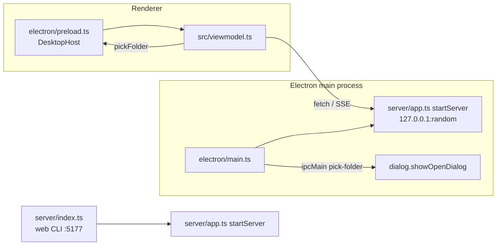

# Add Electron desktop app sharing the web app's code

## Planning phase

**User:** I'd like you to make an Electron version of this app, sharing as much code as possible with the web version. Make and push a commit for it too

**Assistant (proposed plan):**
- Move the route setup out of `server/index.ts` into an exported `startServer` (`server/app.ts`); the CLI entry point becomes a thin wrapper.
- New `electron/main.ts` starts that server on a random loopback port and opens a `BrowserWindow` on it, so the UI, viewmodel, `shared/` and `server/` code are fully shared.
- esbuild bundles the main process into `dist-electron/`; add an `npm run electron` script, with the ffmpeg check run first.
- Tests: `startServer` serves `/api/state` and the built client on an ephemeral port. README section.
- Don't commit others' uncommitted changes.

## Questions and answers

1. **How should the Electron renderer talk to the backend?** (Embedded HTTP server, recommended / IPC transport)
   → User: "Is the backend written in TypeScript? Could it be implemented as a web worker?"
   - Follow-up: The backend is TypeScript (`server/*.ts`, run with tsx). A web worker isn't recommended. It needs Node fs/child_process, which means Node integration in the renderer. It would die on window reload, killing encodes. And the viewmodel speaks fetch/EventSource, so it would still need an IPC-style transport. Options offered: main process + HTTP (recommended), utilityProcess + HTTP, or web worker + IPC.
   → **Main process + HTTP.**
2. **Native Browse… folder pickers?** → **Yes, Electron-only.**
3. **Packaging?** → **Run-from-source only.**
4. **Ticket number?** → **Commit without it.**

## Assumptions made without asking

- Choosing a folder with the "Add media" Browse… button adds it immediately, rather than only filling the textbox.
- The Electron app shares the web version's state file (`~/.batch-recompressor/state.json`).
- I dropped the `electron:dev` script from the plan. The renderer is identical to the web UI, which `npm run dev` already covers, and supporting hot reload would need fixed ports plus wait-for-Vite logic.
- The Electron server binds `127.0.0.1` only; the web server keeps binding all interfaces.

## Architecture

## End phase

- Second pass (subagent): only comment improvements (the reason for the MobX `desktop: false` override, the `startServer` doc, the reason for the late import in the server test). Concerns it raised:
  - Fixed: a startup failure in `electron/main.ts` was unhandled. It now shows an error box and quits.
  - Not fixed: nothing explicitly kills running ffmpeg processes on quit. On Windows, libuv's job object kills child processes when the app exits. Elsewhere, ffmpeg loses its stderr pipe. Same lack of explicit cleanup as the web server.
  - Not fixed: pre-existing. The API has no authentication. Electron narrows exposure to loopback and a random port.
- Tests: typecheck passes; all 103 vitest tests pass (run from `D:\batch-recompressor`, the same folder as `C:\Dev\batch-recompressor`; from the C: path, vitest fails to load jsdom test files for an environmental reason unrelated to this change).
- Manually launched with `electron .`: the window loaded the shared UI from the embedded server and showed the Browse… buttons.
- Polluted working tree: uncommitted changes I didn't make, to `src/components/DetailPage.tsx` (table layout/containment), `tests/app.test.tsx`, `scripts/repro-edge-compositor-stall.md`, plus untracked `AGENTS.md`, `CLAUDE.md`, `diagnostics/`, were left out of the commit; only my Browse… hunks of `DetailPage.tsx` were staged.
